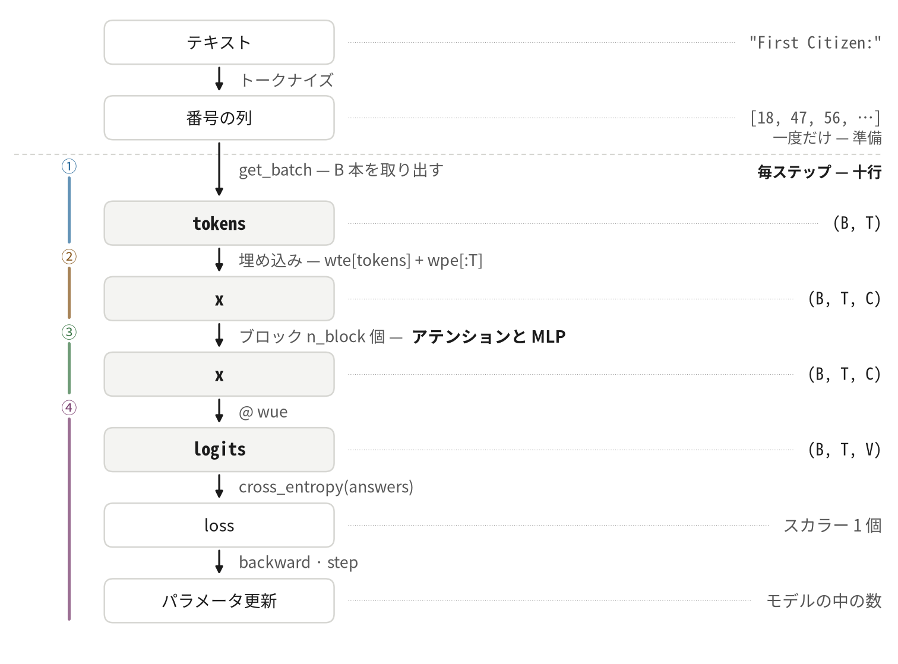
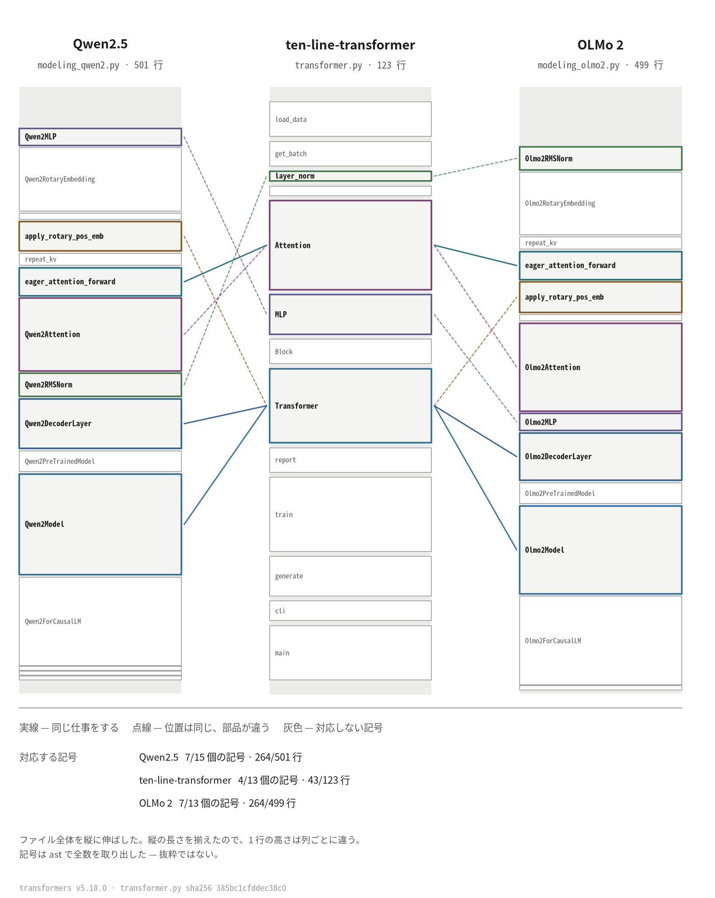

# ten-line-transformer

[🇬🇧 English](README.md) · [🇰🇷 한국어](README.ko.md) · **🇯🇵 日本語** · [🇨🇳 中文](README.zh.md)

トランスフォーマーが Python ファイル 1 枚に収まっています。**123 行**で、学習・検証・
生成がすべて入っています。モジュール変数もコメントもありません — 関数名がコメントの
代わりをします。

[](https://github.com/YoungjuneKwon/ten-line-transformer/actions/workflows/reproduce.yml)
[](LICENSE)
[](transformer.py)
[](#動かしてみる)
[](https://colab.research.google.com/github/YoungjuneKwon/ten-line-transformer/blob/main/notebook.ipynb)

一度に読みきれるほど小さく、それでいて実際に学習が回ります。普通はどちらかを
あきらめるところですが、その必要がないことを示すためにあるリポジトリです。

---

## 学習の 1 ステップは十行です

```python
tokens, answers = get_batch()               # (B, T), (B, T)
optimizer.zero_grad(set_to_none=True)
x = wte[tokens] + wpe[:T]                   # (B, T, C)
for blk in blocks:                          # n_block 回
    x = x + blk.attn(layer_norm(x))         # (B, T, C)
    x = x + blk.mlp(layer_norm(x))          # (B, T, C)
logits = layer_norm(x) @ wue                # (B, T, V)
loss = cross_entropy(logits, answers)       # スカラー 1 個
loss.backward()
optimizer.step()
```

実際のファイルでは、真ん中の六行が
[`Transformer.forward()`](transformer.py#L66-L72) の中に、残りの四行が
[`train()`](transformer.py#L80-L94) にあります。



破線が二つの時計を分けています。上はテキストを読むときに **一度だけ** 行うこと、
下が **毎ステップ** 回る十行です。境界をまたぐ矢印が `get_batch` であること自体が
答えになっています — 一度作った配列から毎ステップ取り出すのです。

右の列だけを読めば、形状の話がまるごと見えます。`(B, T)` の整数が入り、
`(B, T, C)` の実数になり、ブロックを抜けるあいだずっとその形状を保ち、最後の行列で
`(B, T, V)` に開き、数ひとつに畳まれます。

---

## 動かしてみる

ブラウザさえあれば上の Colab バッジからそのまま動きます。手元の計算機で回すには
PyTorch とテキストファイルが 1 つあれば足ります。

```bash
pip install torch
curl -O https://raw.githubusercontent.com/karpathy/char-rnn/master/data/tinyshakespeare/input.txt
OMP_NUM_THREADS=1 python transformer.py 200 input.txt
```

CPU で動きます。グラフィックスカードは要りません。

---

## 同じ数が出ます

11 行を目で照合しなくて済みます。コマンド 1 つが答えます。

```bash
python scripts/check_reproduction.py
```

学習を回し、コーパスの md5 を確かめ、すべての行を照合して **SAME**（同じ）か
**DIFFERENT**（違う）かを言います。違う場合は issue にそのまま貼れるブロックを
作ってくれます — torch のバージョンとプラットフォームは記入済みです。

シードは 1337 に固定しています。以下は上のコマンドの出力の全文です。CPU だけの
コンテナで取ったもので、切り落としたところはありません。

```
  step     train       val     sec
     0    4.2006    3.9836     0.2
    20    3.4308    3.4368     3.0
    40    3.2868    3.3116     5.7
    60    2.9855    3.1101     8.4
    80    2.7989    2.8680    11.2
   100    2.7746    2.7454    14.1
   120    2.6514    2.6279    16.8
   140    2.6177    2.6219    19.5
   160    2.5419    2.6296    22.2
   180    2.5292    2.5087    24.9
   200    2.5400    2.4785    27.5
```

`sec` は機械ごとに違います。**損失の値は違いません。** そしてこれは私の言い分だけでは
ありません。上のバッジが、まさにこの照合を GitHub のランナー上で、push のたびと週に
一度、回しています。直近の実行では、私と何も共有しないハードウェアとソフトウェアで
11 行すべてが一致しました。

| | 基準値を測った私の側 | GitHub のランナー |
|---|---|---|
| CPU | CPU だけのコンテナ | AMD EPYC 7763・Azure |
| torch | 2.14.0+cpu | 2.14.1+cpu |
| Python | 3.11.2 | 3.11.17 **と** 3.12 |
| glibc | 2.36 | 2.39 |

照合する前に一つ知っておいてください。この数は **ステップではなくコマンドに**
ひもづきます。`transformer.py` は指定されたステップ数を十で割って報告し、報告の
たびに学習バッチと同じ乱数源から検証バッチを 1 つ引きます。2000 ステップを指定すると
報告が 200 ごとになるので引く回数が変わり、200 ステップの位置が `2.5400` ではなく
`2.4812` と読めます。同じシード、同じコード、違う引き方の日程です。**同じコマンド
どうし**で比べてください。

**同じコマンドなのに数が違ったら、issue を立ててください。** このリポジトリが
いちばん聞きたいことです — 何を書けばよいかは [CONTRIBUTING.md](CONTRIBUTING.md)
にあります。

### その 27 秒のあとに書くもの

```
AGORAnt ther
F:
uan'se tes? ce ares cikny alllow ld I
Sor sin.

ITander thewineungh hlelus met t there pr sangand berdar the,, the, dpas our me t here,
T bro winomerese vean wil:
Ak, migpr, and ttmy foungomele fe ble, t theran busmun mesI,
```

英語ではありません。しかし 200 ステップがすでに買ってきたものを見てください —
行がだいたい同じ長さで折れ、大文字の名前のうしろにコロンが付き、アポストロフィが
語の外ではなく中に入っています。そのどれにも規則を書いてやった人はいません。
回ったのは上の十行だけです。

### 4 分半のあとには

`OMP_NUM_THREADS=1 python transformer.py 2000 input.txt` — 同じ CPU で 265 秒、
損失 1.64 です。

```
ISABELLA:
Whas our tleagues the say! or would so piar.
Two low hereful Lond May to those here enfenablish,
That is that her here come is some not that thy whid
Is chart gare of certy, and cantive she duke again,
Let I same the heart son's good fathen again,
To be that mone at that pray of heaved have both
As the gates the send speak in the did.

BARTICHARD:
Thou day the king, and of Englest, is an breath;
```

`ISABELLA` はコーパスに実在する話者で、129 回出てきます。`BARTICHARD` は一度も
出てきません — 見たことのある名前に似た断片を寄せ集めて、モデルが作ったものです。
どちらの振る舞いも同じ十行から出てきますし、ノートパソコンで 5 分もかからずに
それが届くのを見られます。

### 次は壊してみてください

ある行が何のためにあるかを学ぶいちばん速い道は、その行を消してみることです。
マスク、つまり [38 行目](transformer.py#L38) を消すと、損失が 2.54 から **0.74** に
下がります。3 倍よく見える数で、値打ちはありません — 当てるべき答えをモデルが
見られるようになったからです。

**[docs/try-this.md](docs/try-this.md) にそれが 6 つあります。** どれも 1 ファイルだけ
直す編集で、測った結果が付いています — マスク、アテンション、残差、幅、深さ、シード。
そのうち 1 つは 200 ステップの
言い分をひっくり返します。どれかを突き止めるのが練習です。

---

## モデル

6 つの文字が設定のすべてを運びます。コードと、上のすべての図が使っている文字と
同じものです。

| | | |
|---|---|---|
| `B` | バッチ — 一度に何本の系列を学習するか | 32 |
| `T` | 時間 — モデルが何文字まで遡って見られるか | 64 |
| `C` | チャネル — 1 文字がなるベクトルの幅 | 128 |
| `H` | ヘッド — アテンションヘッドの数。1 つが `C/H` の幅 | 4 |
| `V` | 語彙 — コーパス内の異なる文字の数。数えて出た値 | 65 |
| `n_block` | アテンションと MLP を何回積むか | 4 |

```
B=32  T=64  C=128  H=4  n_block=4      学習されるテンソル 19 枚、数 811,264 個
wte (65,128)  wpe (64,128)  wue (128,65)
blocks.N.attn.qkv (384,128)  attn.proj (128,128)  mlp.fc (512,128)  mlp.out (128,512)
```

バイアス、ドロップアウト、学習される正規化係数、重み共有は **わざと外しました。**
構造を見せるのに要らないものですし、外せば読むものが減ります。

---

## 同じ場所が実際のモデルにもあります

言うのは簡単で確かめるのが難しい主張が *「大きいものも同じように動く」* です。
そこで主張する代わりに描きました。左右の列は
[huggingface/transformers](https://github.com/huggingface/transformers) の実際の
モデルコードで、タグ `v5.18.0` に固定しています。ファイルは上から下まで丸ごと
伸ばしてあり、記号は `ast` で全数を取り出しました — 手で選んだ抜粋ではありません。



ここで記号 4 個・43 行がする仕事を、Qwen2.5 は記号 7 個・264 行でします。その差は
ほとんどすべて **このファイルが外した部品** です — 回転位置埋め込み、グループ化
クエリアテンション、キャッシュ、設定まわりの配管。違う考えではありません。

**[docs/line-mapping.md](docs/line-mapping.md) がこの図の裏にある表です。** 場所ごとに
こちらの行番号と、Qwen2.5・Llama・OLMo 2 の対応する行の範囲を、その行へ直接飛ぶ
リンクで書いてあります。どの行を押しても、見ているのは本物のファイルです。間違った
行があれば、それは issue を立てる価値のあるバグです。

---

## どこから来たか

公開されている [nanoGPT](https://github.com/karpathy/nanoGPT) を下敷きに、PyTorch で
大きく書き直したものです。文字単位で比べると、ファイル全体で 1.3%、アテンション
本体で 22.6% が重なります。それでも **計算の順序は十段階が同じ** です。

```
qkv 射影 -> 3 分割 -> ヘッド分離 -> q·kᵀ -> √ で割る
        -> マスク -> softmax -> @ v -> ヘッド結合 -> 出力射影
```

書き直すあいだ、結果が変わっていないかを毎回確かめました。同じシードで 200 ステップ
回すと、学習された 811,264 個の数が **1 ビットも違いません**（スレッドを 1 つに
固定した場合。複数スレッドでは足す順序が変わって最後の桁が揺れます）。

どこが どこから来たかを行単位で書いたものは [NOTICE.md](NOTICE.md) にあります。

### では nanoGPT を読めばいいのでは

たいていはそのとおりです。ほとんどの目的ではあちらが良いリポジトリですし、それが
なければこのファイルはありません。違うのは **何のために作ったか** です。

| | nanoGPT | ここ |
|---|---|---|
| 散らばっている場所 | `model.py` 330 行・`train.py` 336・`sample.py` 89・`configurator.py` 47 | 1 ファイル 123 行 |
| 作った目的 | **学習** — GPT-2 の重み、DDP、`torch.compile`、設定の仕組み | **読むこと** — そのどれもない |
| モジュール変数 | ある。設定がそこに住む | ない |
| コメント | ある | ないのが設計 — 名前がその仕事をする |
| 公開された数 | ない | ある。シード固定、[push のたびに照合](#同じ数が出ます) |
| 実モデルとの対応 | ない | [行単位で](docs/line-mapping.md)、タグ固定 |

モデルを **学習させたい** なら nanoGPT を使ってください。半日で 1 つ **読んで**、
そのあと自分で Qwen2.5 に当ててみたいのなら、それがこのリポジトリです。

---

## 貢献

ここでは機能より **訂正** のほうが値打ちがあります — このファイルは読まれるために
あり、育つためにあるのではありません。このリポジトリがいちばん反証してほしい主張を
[CONTRIBUTING.md](CONTRIBUTING.md) に並べてあります。

コードの動き方についての質問は
[Discussions](https://github.com/YoungjuneKwon/ten-line-transformer/discussions)
へお願いします。issue は **間違っているもの** のための場所です。

## ライセンス

MIT。第三者の著作物の告知は [NOTICE.md](NOTICE.md) にあります。

上の図は描いたものではなく生成されたものです —
`python scripts/make_figures.py` が 4 言語分すべてを描き直します。
