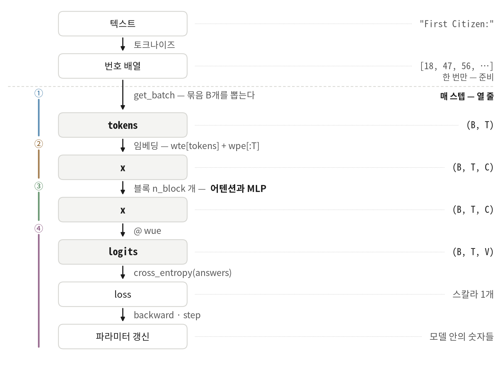
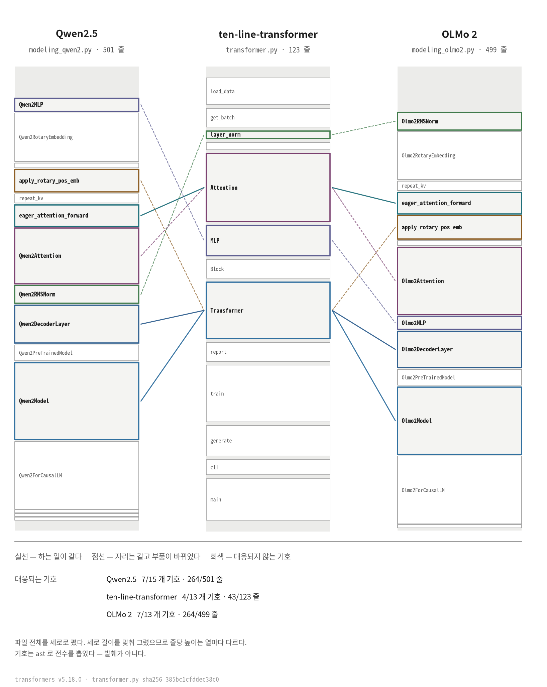

# ten-line-transformer

[🇬🇧 English](README.md) · **🇰🇷 한국어** · [🇯🇵 日本語](README.ja.md) · [🇨🇳 中文](README.zh.md)

트랜스포머 하나가 파이썬 파일 한 장에 들어 있습니다. **123줄**이고 학습·검증·생성이
다 있습니다. 모듈 수준 변수도, 주석도 없습니다 — 함수 이름이 주석을 대신합니다.

[](https://github.com/YoungjuneKwon/ten-line-transformer/actions/workflows/reproduce.yml)
[](LICENSE)
[](transformer.py)
[](#돌려-보기)
[](https://colab.research.google.com/github/YoungjuneKwon/ten-line-transformer/blob/main/notebook.ko.ipynb)

한자리에서 다 읽을 만큼 작고, 그러면서 실제로 학습이 됩니다. 보통은 둘 중 하나를
포기하는데, 그러지 않아도 된다는 것을 보이려고 있는 저장소입니다.

---

## 학습 한 스텝은 열 줄입니다

```python
tokens, answers = get_batch()               # (B, T), (B, T)
optimizer.zero_grad(set_to_none=True)
x = wte[tokens] + wpe[:T]                   # (B, T, C)
for blk in blocks:                          # n_block 번
    x = x + blk.attn(layer_norm(x))         # (B, T, C)
    x = x + blk.mlp(layer_norm(x))          # (B, T, C)
logits = layer_norm(x) @ wue                # (B, T, V)
loss = cross_entropy(logits, answers)       # 스칼라 1개
loss.backward()
optimizer.step()
```

실제 파일에서는 가운데 여섯 줄이
[`Transformer.forward()`](transformer.py#L66-L72) 안에 있고, 나머지 넷이
[`train()`](transformer.py#L80-L94) 에 있습니다.



점선이 두 개의 시계를 가릅니다. 위는 텍스트를 읽을 때 **한 번만** 하는 일이고,
아래가 **매 스텝** 도는 열 줄입니다. 경계를 가로지르는 화살표가 `get_batch` 인
것이 그 자체로 답입니다 — 한 번 만들어 둔 배열에서 매 스텝 뽑아 옵니다.

오른쪽 열만 따로 읽으면 형상의 이야기가 통째로 보입니다. `(B, T)` 정수로 들어가
`(B, T, C)` 실수가 되고, 블록을 다 지나는 동안 그 형상을 유지하다가, 마지막 행렬에서
`(B, T, V)` 로 열리고, 숫자 하나로 접힙니다.

---

## 돌려 보기

브라우저만 있으면 위의 Colab 배지로 바로 돌아갑니다. 내 컴퓨터에서 돌리려면
파이토치와 텍스트 파일 하나가 필요합니다.

```bash
pip install torch
curl -O https://raw.githubusercontent.com/karpathy/char-rnn/master/data/tinyshakespeare/input.txt
OMP_NUM_THREADS=1 python transformer.py 200 input.txt
```

CPU 로 돌아갑니다. 그래픽카드는 없어도 됩니다.

---

## 같은 숫자가 나옵니다

열한 행을 눈으로 대조하지 않으셔도 됩니다. 명령 하나가 답합니다.

```bash
python scripts/check_reproduction.py
```

학습을 돌리고, 말뭉치 md5 를 보고, 모든 행을 대조해서 **같다(SAME)** 또는
**다르다(DIFFERENT)** 를 말합니다. 다르면 이슈에 그대로 붙일 블록을 만들어
줍니다 — 토치 버전과 플랫폼이 이미 채워져 있습니다.

시드를 1337로 고정했습니다. 아래가 위 명령의 출력 전문입니다. CPU 만 있는
컨테이너에서 받은 것이고, 잘라낸 곳이 없습니다.

```
  step     train       val     sec
     0    4.2006    3.9836     0.2
    20    3.4308    3.4368     3.0
    40    3.2868    3.3116     5.7
    60    2.9855    3.1101     8.4
    80    2.7989    2.8680    11.2
   100    2.7746    2.7454    14.1
   120    2.6514    2.6279    16.8
   140    2.6177    2.6219    19.5
   160    2.5419    2.6296    22.2
   180    2.5292    2.5087    24.9
   200    2.5400    2.4785    27.5
```

`sec` 는 기기마다 다릅니다. **손실 값은 다르지 않습니다.** 그리고 이건 제 말만이
아닙니다. 맨 위 배지가 바로 이 대조를 깃헙 러너에서 매 푸시마다, 그리고 매주 한 번
돌립니다. 가장 최근 실행은 저와 아무것도 공유하지 않는 기계·소프트웨어에서 열한 행이
전부 맞았습니다.

| | 기준값을 잰 제 쪽 | 깃헙 러너 |
|---|---|---|
| CPU | CPU 전용 컨테이너 | AMD EPYC 7763 · Azure |
| torch | 2.14.0+cpu | 2.14.1+cpu |
| Python | 3.11.2 | 3.11.17 **과** 3.12 |
| glibc | 2.36 | 2.39 |

대조하기 전에 하나 알아 두실 것이 있습니다. 이 숫자들은 **스텝이 아니라 명령에**
붙습니다. `transformer.py` 는 시킨 스텝 수를 열로 나눠 보고하고, 보고할 때마다
학습 묶음과 같은 난수원에서 검증 묶음을 하나 뽑습니다. 2000 스텝을 시키면 보고가
200 마다 떨어지므로 뽑는 횟수가 달라지고, 그래서 200 스텝 자리가 `2.5400` 이 아니라
`2.4812` 로 읽힙니다. 같은 시드, 같은 코드, 다른 뽑기 일정입니다. **같은 명령끼리**
비교해 주십시오.

**같은 명령인데 숫자가 다르게 나오면 이슈를 열어 주십시오.** 이 저장소가 가장
듣고 싶은 것이고, 무엇을 적어 주시면 되는지는 [CONTRIBUTING.md](CONTRIBUTING.md)
에 있습니다.

### 그 27초 뒤에 이 파일이 쓰는 것

```
AGORAnt ther
F:
uan'se tes? ce ares cikny alllow ld I
Sor sin.

ITander thewineungh hlelus met t there pr sangand berdar the,, the, dpas our me t here,
T bro winomerese vean wil:
Ak, migpr, and ttmy foungomele fe ble, t theran busmun mesI,
```

영어가 아닙니다. 그런데 200 스텝이 이미 사 온 것을 보십시오 — 줄이 비슷한 길이에서
꺾이고, 대문자 이름 뒤에 콜론이 붙고, 아포스트로피가 단어 바깥이 아니라 안에
들어가 있습니다. 그중 어느 것에도 규칙을 적어 준 사람이 없습니다. 돈 것은 위의 열
줄뿐입니다.

### 4분 반 뒤에는

`OMP_NUM_THREADS=1 python transformer.py 2000 input.txt` — 같은 CPU 에서 265초,
손실 1.64 입니다.

```
ISABELLA:
Whas our tleagues the say! or would so piar.
Two low hereful Lond May to those here enfenablish,
That is that her here come is some not that thy whid
Is chart gare of certy, and cantive she duke again,
Let I same the heart son's good fathen again,
To be that mone at that pray of heaved have both
As the gates the send speak in the did.

BARTICHARD:
Thou day the king, and of Englest, is an breath;
```

`ISABELLA` 는 말뭉치에 실재하는 화자입니다 — 129번 나옵니다. `BARTICHARD` 는
한 번도 나오지 않습니다. 본 적 있는 이름처럼 생긴 조각들을 모아 모델이 지어낸
것입니다. 두 행동이 같은 열 줄에서 나오고, 노트북으로 5분 안에 그것이 도착하는
것을 볼 수 있습니다.

---

## 모델

글자 여섯 개가 설정 전부를 나릅니다. 코드와 위의 그림들이 쓰는 글자와 같습니다.

| | | |
|---|---|---|
| `B` | 묶음 — 한 번에 몇 개의 열을 학습하나 | 32 |
| `T` | 시간 — 모델이 몇 글자까지 거슬러 볼 수 있나 | 64 |
| `C` | 채널 — 글자 하나가 되는 벡터의 폭 | 128 |
| `H` | 헤드 — 어텐션 헤드가 몇 개인가. 하나가 `C/H` 폭이다 | 4 |
| `V` | 어휘 — 말뭉치 안의 서로 다른 글자 수. 세어서 나온 값이다 | 65 |
| `n_block` | 어텐션과 MLP 를 몇 번 쌓나 | 4 |

```
B=32  T=64  C=128  H=4  n_block=4      학습되는 텐서 19장, 숫자 811,264개
wte (65,128)  wpe (64,128)  wue (128,65)
blocks.N.attn.qkv (384,128)  attn.proj (128,128)  mlp.fc (512,128)  mlp.out (128,512)
```

편향, 드롭아웃, 학습되는 정규화 계수, 가중치 묶기는 **일부러 뺐습니다.** 구조를
보이는 데 필요하지 않고, 빼면 읽을 것이 줄어듭니다.

---

## 같은 자리가 실제 모델에도 있습니다

말하기는 쉽고 확인하기는 어려운 주장이 *「큰 것들도 이렇게 돌아간다」* 입니다.
그래서 주장 대신 그렸습니다. 양쪽 바깥 두 열은
[huggingface/transformers](https://github.com/huggingface/transformers) 의 실제
모델 코드이고, 태그 `v5.18.0` 으로 고정했습니다. 파일을 통째로 위에서 아래까지
폈고, 기호는 `ast` 로 전수를 뽑았습니다 — 손으로 고른 발췌가 아닙니다.



여기서 기호 4개 43줄이 하는 일을, Qwen2.5 는 기호 7개 264줄로 합니다. 그 차이는
거의 전부 **이 파일이 빼 둔 부품들**입니다 — 회전 위치 임베딩, 그룹 쿼리 어텐션,
캐시, 설정 배관. 다른 생각이 아닙니다.

**[docs/line-mapping.md](docs/line-mapping.md) 가 이 그림 뒤의 표입니다.** 자리마다
우리 줄 번호와 Qwen2.5·Llama·OLMo 2 의 대응 줄 범위를, 그 줄로 바로 가는 링크로
적었습니다. 아무 행이나 눌러 보시면 실제 파일을 보고 계신 겁니다. 틀린 행이 있으면
그건 이슈를 열 만한 버그입니다.

---

## 어디서 왔나

온라인에 공개된 [nanoGPT](https://github.com/karpathy/nanoGPT)를 바탕에 두고
파이토치로 대대적으로 다시 썼습니다. 글자 단위로 비교하면 파일 전체가 1.3%,
어텐션 본문이 22.6% 겹칩니다. 그런데 **계산의 순서는 열 단계가 같습니다.**

```
qkv 사영 -> 3분할 -> 헤드 분리 -> q·kᵀ -> √ 로 나눔
        -> 마스크 -> softmax -> @ v -> 헤드 병합 -> 출력 사영
```

다시 쓰는 동안 결과가 달라지지 않았는지 매번 확인했습니다. 같은 시드로 200 스텝을
돌리면 학습된 숫자 811,264개가 **한 비트도 다르지 않습니다**(스레드를 하나로
고정했을 때. 여러 스레드로 돌리면 더하는 순서가 달라져 마지막 자리가 흔들립니다).

어디가 어디서 왔는지를 줄 단위로 적은 것은 [NOTICE.md](NOTICE.md) 에 있습니다.

### 그러면 그냥 nanoGPT 를 읽으면 되지 않나

대개는 그게 맞습니다. 거의 모든 목적에서 더 나은 저장소이고, 그것 없이는 이 파일이
없었습니다. 다른 것은 **무엇을 하려고 만들었나**입니다.

| | nanoGPT | 여기 |
|---|---|---|
| 흩어진 자리 | `model.py` 330줄 · `train.py` 336 · `sample.py` 89 · `configurator.py` 47 | 한 파일 123줄 |
| 만든 목적 | **학습** — GPT-2 가중치, DDP, `torch.compile`, 설정 체계 | **읽기** — 그중 아무것도 없다 |
| 모듈 수준 상태 | 있다. 설정이 거기 산다 | 없다 |
| 주석 | 있다 | 없는 것이 설계다 — 이름이 그 일을 한다 |
| 공개된 숫자 | 없다 | 있다. 시드 고정, [매 푸시마다 대조](#같은-숫자가-나옵니다) |
| 실제 모델과의 대응 | 없다 | [줄 단위로](docs/line-mapping.md), 태그 고정 |

모델을 **학습시키려면** nanoGPT 를 쓰십시오. 한나절에 하나를 **읽고** 그다음 직접
Qwen2.5 에 대 보려는 것이라면, 그게 이 저장소입니다.

---

## 책

집필 중인 책 『열 줄로 읽는 트랜스포머』(가제)가 이 파일을 처음부터 끝까지 읽습니다.
책 없이 코드만 읽어도 되고, 책은 이 저장소에 들어 있지 않습니다.

## 기여

여기서는 기능보다 **정정**이 값어치가 큽니다 — 이 파일은 읽히기 위해 있고 자라기
위해 있지 않습니다. 이 저장소가 가장 반증받고 싶은 주장들을
[CONTRIBUTING.md](CONTRIBUTING.md) 에 적어 두었습니다.

코드가 어떻게 돌아가는지에 대한 질문은
[Discussions](https://github.com/YoungjuneKwon/ten-line-transformer/discussions)
에 올려 주십시오. 이슈는 **틀린 것**을 위한 자리입니다.

## 라이선스

MIT. 출처 고지는 [NOTICE.md](NOTICE.md) 에 있습니다.

위의 그림들은 그린 것이 아니라 만들어진 것입니다 —
`python scripts/make_figures.py` 가 네 언어 전부를 다시 그립니다.
