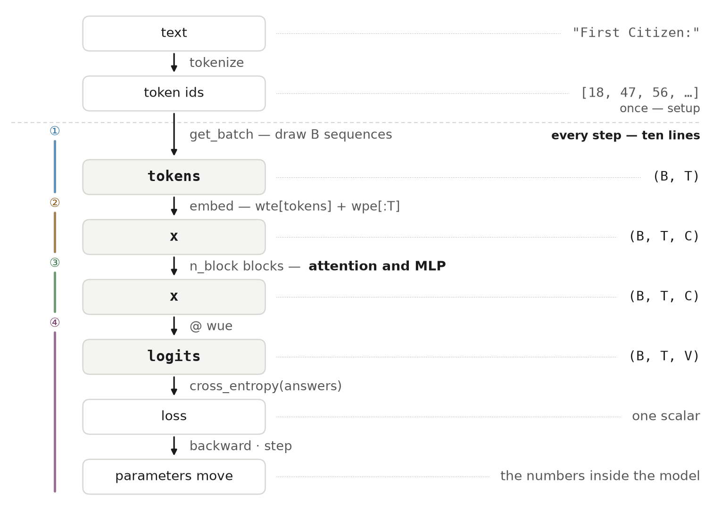
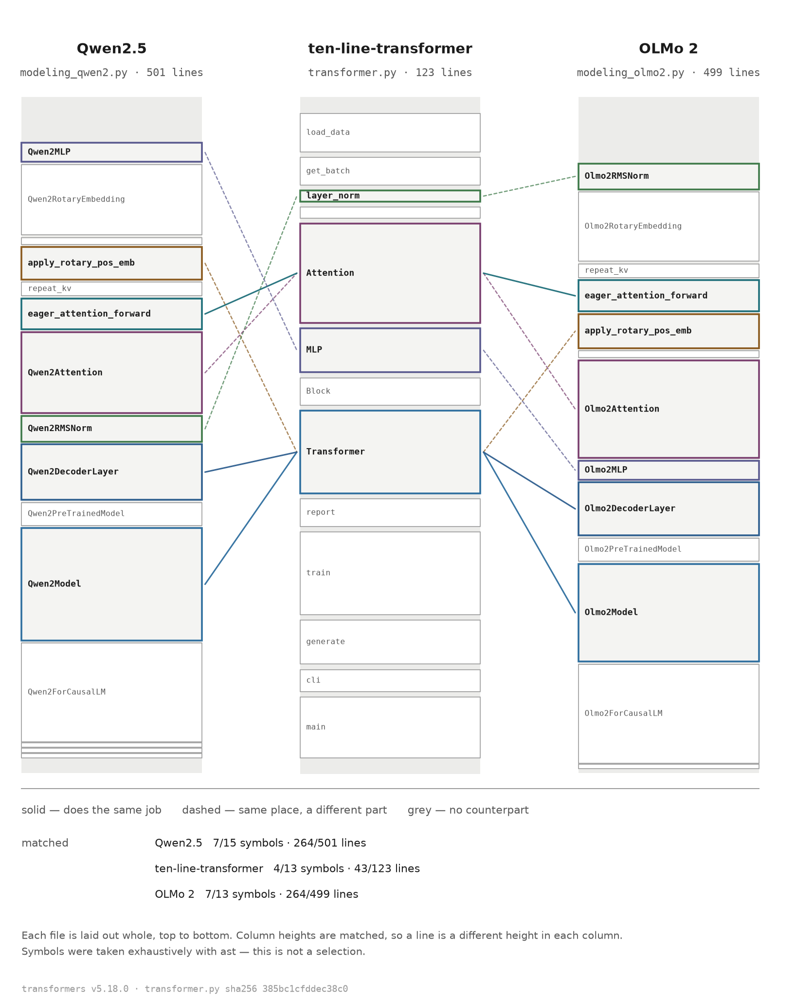

# ten-line-transformer

**🇬🇧 English** · [🇰🇷 한국어](README.ko.md) · [🇯🇵 日本語](README.ja.md) · [🇨🇳 中文](README.zh.md)

A transformer in one Python file. **123 lines**, with training, validation and
generation all in it. No module-level variables and no comments — the function
names stand in for the comments.

[](https://github.com/YoungjuneKwon/ten-line-transformer/actions/workflows/reproduce.yml)
[](LICENSE)
[](transformer.py)
[](#running-it)
[](https://colab.research.google.com/github/YoungjuneKwon/ten-line-transformer/blob/main/notebook.ipynb)

Small enough to read in one sitting, complete enough to train. Those two are
usually traded against each other, and this repository exists to show they do
not have to be.

---

## One training step is ten lines

```python
tokens, answers = get_batch()               # (B, T), (B, T)
optimizer.zero_grad(set_to_none=True)
x = wte[tokens] + wpe[:T]                   # (B, T, C)
for blk in blocks:                          # n_block times
    x = x + blk.attn(layer_norm(x))         # (B, T, C)
    x = x + blk.mlp(layer_norm(x))          # (B, T, C)
logits = layer_norm(x) @ wue                # (B, T, V)
loss = cross_entropy(logits, answers)       # one scalar
loss.backward()
optimizer.step()
```

That block is one training step with the plumbing taken out. **Five of the ten
lines are in the file character for character** — `optimizer.zero_grad`, the two
`x = x + ...` lines, `loss.backward()` and `optimizer.step()`. The other five do
the same work with `self.` and the arguments put back, and with the loss coming
out of `forward` rather than sitting on a line of its own. Read them side by
side: [`Transformer.forward()`](transformer.py#L66-L72) and
[`train()`](transformer.py#L80-L94).



The dashed line separates two clocks. Everything above it happens **once**, when
the text is loaded; everything below happens on **every step**, and that is the
ten lines. `get_batch` is the arrow that crosses the line — the array is built
once and drawn from each step.

Read the right-hand column on its own and you have the whole shape story.
`(B, T)` goes in as integers, becomes `(B, T, C)` floats, keeps that shape all
the way through the blocks, opens out to `(B, T, V)` at the last matrix, and
collapses to one number.

---

## Running it

The Colab badge above needs nothing but a browser. On your own machine you need
PyTorch and one text file.

```bash
pip install torch
curl -O https://raw.githubusercontent.com/karpathy/char-rnn/master/data/tinyshakespeare/input.txt
OMP_NUM_THREADS=1 python transformer.py 200 input.txt
```

It runs on CPU. No graphics card required.

---

## You get the same numbers

One command answers it, so you do not have to compare eleven rows by eye:

```bash
python scripts/check_reproduction.py
```

It runs the training, checks the corpus md5, compares every row, and says SAME
or DIFFERENT. If it says DIFFERENT it prints the block to paste into an issue,
with your torch version and platform already filled in.

The seed is fixed at 1337. This is the whole output of the command above on a
CPU-only container, nothing trimmed:

```
  step     train       val     sec
     0    4.2006    3.9836     0.2
    20    3.4308    3.4368     3.0
    40    3.2868    3.3116     5.7
    60    2.9855    3.1101     8.4
    80    2.7989    2.8680    11.2
   100    2.7746    2.7454    14.1
   120    2.6514    2.6279    16.8
   140    2.6177    2.6219    19.5
   160    2.5419    2.6296    22.2
   180    2.5292    2.5087    24.9
   200    2.5400    2.4785    27.5
```

The `sec` column differs by machine. **The loss values do not** — and that is
not just my word for it. The badge at the top runs exactly this on GitHub's
runners, on every push and once a week. Most recently it matched all eleven
rows on hardware and software that share nothing with mine:

| | mine, where the reference came from | GitHub's runner |
|---|---|---|
| CPU | a CPU-only container | AMD EPYC 7763, Azure |
| torch | 2.14.0+cpu | 2.14.1+cpu |
| Python | 3.11.2 | 3.11.17 **and** 3.12 |
| glibc | 2.36 | 2.39 |

One thing to know before you compare: the numbers belong to the *command*, not
to the step. `transformer.py` reports ten times whatever you ask for, and each
report draws a validation batch from the same generator the training batches
come from. Ask for 2000 steps and the reports land every 200, so the draws
differ and step 200 reads `2.4812` instead of `2.5400`. Same seed, same code,
different schedule of draws. Compare runs of the same command.

**If your numbers differ for the same command, please open an issue.** That is
the one thing this repository most wants to hear about — see
[CONTRIBUTING.md](CONTRIBUTING.md).

### What it writes after those 27 seconds

```
AGORAnt ther
F:
uan'se tes? ce ares cikny alllow ld I
Sor sin.

ITander thewineungh hlelus met t there pr sangand berdar the,, the, dpas our me t here,
T bro winomerese vean wil:
Ak, migpr, and ttmy foungomele fe ble, t theran busmun mesI,
```

Not English. But look at what 200 steps already bought: lines break at about the
right length, a name in capitals is followed by a colon, an apostrophe sits
inside a word rather than outside it. Nobody wrote a rule for any of that. The
ten lines above are the only thing that ran.

### And after four and a half minutes

`OMP_NUM_THREADS=1 python transformer.py 2000 input.txt` — 265 seconds on the
same CPU, loss 1.64:

```
ISABELLA:
Whas our tleagues the say! or would so piar.
Two low hereful Lond May to those here enfenablish,
That is that her here come is some not that thy whid
Is chart gare of certy, and cantive she duke again,
Let I same the heart son's good fathen again,
To be that mone at that pray of heaved have both
As the gates the send speak in the did.

BARTICHARD:
Thou day the king, and of Englest, is an breath;
```

`ISABELLA` is a real speaker in the corpus — she has 129 lines in it.
`BARTICHARD` has none: the model assembled that name out of pieces that look
like the names it saw. Both behaviours come from the same ten lines, and you can
watch them arrive in under five minutes on a laptop.

### Now break it

The fastest way to learn what a line is for is to delete it. Delete
[line 38](transformer.py#L38), the mask, and the loss falls from 2.54 to
**0.74** — a number three times better that is worth nothing, because the model
can now see the answer it is being asked to predict.

**[docs/try-this.md](docs/try-this.md) has six of those**, each a one-file edit
with the measured result: the mask, attention, the residual, the width, the
depth, the seed. One of them overturns what a 200-step run appears to say, and
finding out which one is the exercise.

---

## The model

Six letters carry the whole configuration, and they are the same six letters
used in the code and in every figure above.

| | | |
|---|---|---|
| `B` | batch — how many sequences are trained on at once | 32 |
| `T` | time — how many characters the model can look back over | 64 |
| `C` | channels — the width of the vector each character becomes | 128 |
| `H` | heads — how many attention heads, each `C/H` wide | 4 |
| `V` | vocabulary — distinct characters in the corpus, counted from it | 65 |
| `n_block` | how many times attention and MLP are stacked | 4 |

```
B=32  T=64  C=128  H=4  n_block=4      19 learned tensors, 811,264 numbers
wte (65,128)  wpe (64,128)  wue (128,65)
blocks.N.attn.qkv (384,128)  attn.proj (128,128)  mlp.fc (512,128)  mlp.out (128,512)
```

Biases, dropout, learned normalization coefficients and weight tying are
**left out on purpose.** They are not needed to show the structure, and leaving
them out leaves less to read.

---

## The same places are in the real models

The claim that is easy to make and hard to check is *"this is how the big ones
work too."* So here it is drawn rather than asserted. Both outer columns are
production model code from
[huggingface/transformers](https://github.com/huggingface/transformers) pinned
at tag `v5.18.0`. Every file is laid out whole, top to bottom — the symbols were
taken exhaustively with `ast`, not picked by hand.



Four symbols and 43 lines here do the work that takes seven symbols and 264
lines in Qwen2.5. Almost all of the difference is parts this file leaves out —
rotary embeddings, grouped-query attention, caching, configuration plumbing —
not a different idea.

**[docs/line-mapping.md](docs/line-mapping.md) is the table behind the
picture.** For each place it gives our line number and the matching line range
in Qwen2.5, Llama and OLMo 2, as links that jump straight to the line. Click any
row and you are looking at the real file. If a row is wrong, that is a bug worth
an issue.

---

## Where it came from

Rewritten substantially in PyTorch on top of
[nanoGPT](https://github.com/karpathy/nanoGPT), which is public online.
Compared character by character, 1.3% of the whole file and 22.6% of the
attention body overlap. But **the order of the computation is the same ten
steps.**

```
qkv projection -> split in 3 -> separate heads -> q·kᵀ -> divide by √
        -> mask -> softmax -> @ v -> merge heads -> output projection
```

The result was checked against the original at every step of the rewrite. Run
200 steps with the same seed and the 811,264 learned numbers do not differ by
**a single bit** (with threads pinned to one; with several threads the addition
order changes and the last digit wobbles).

A line-by-line map of what came from where is in [NOTICE.md](NOTICE.md).

### Then why not just read nanoGPT?

Often you should. It is the better repository for most purposes and this one
would not exist without it. The difference is what each is built for.

| | nanoGPT | here |
|---|---|---|
| spread over | `model.py` 330 lines, `train.py` 336, `sample.py` 89, `configurator.py` 47 | one file, 123 |
| built to | **train** — GPT-2 weights, DDP, `torch.compile`, a config system | **be read** — none of that |
| module-level state | yes, the config lives there | none |
| comments | yes | none, by design — the names do that work |
| published numbers | no | yes, fixed seed, [checked on every push](#you-get-the-same-numbers) |
| mapped to shipping models | no | [line by line](docs/line-mapping.md), pinned to a tag |

If you want to train a model, use nanoGPT. If you want to read one in an
afternoon and then go check it against Qwen2.5 yourself, that is what this is.

---

## Contributing

A correction is worth more here than a feature — the file is meant to be read,
not to grow. [CONTRIBUTING.md](CONTRIBUTING.md) lists the claims this repository
would most like to see falsified.

Questions about how the code works belong in
[Discussions](https://github.com/YoungjuneKwon/ten-line-transformer/discussions).
Issues are for things that are wrong.

## License

MIT. Third-party attribution is in [NOTICE.md](NOTICE.md).

The figures are generated, not drawn — `python scripts/make_figures.py` redraws
every one of them in all four languages.

---

Built and maintained by [Second Tiger](https://secondtiger.com), a one-person software label.
