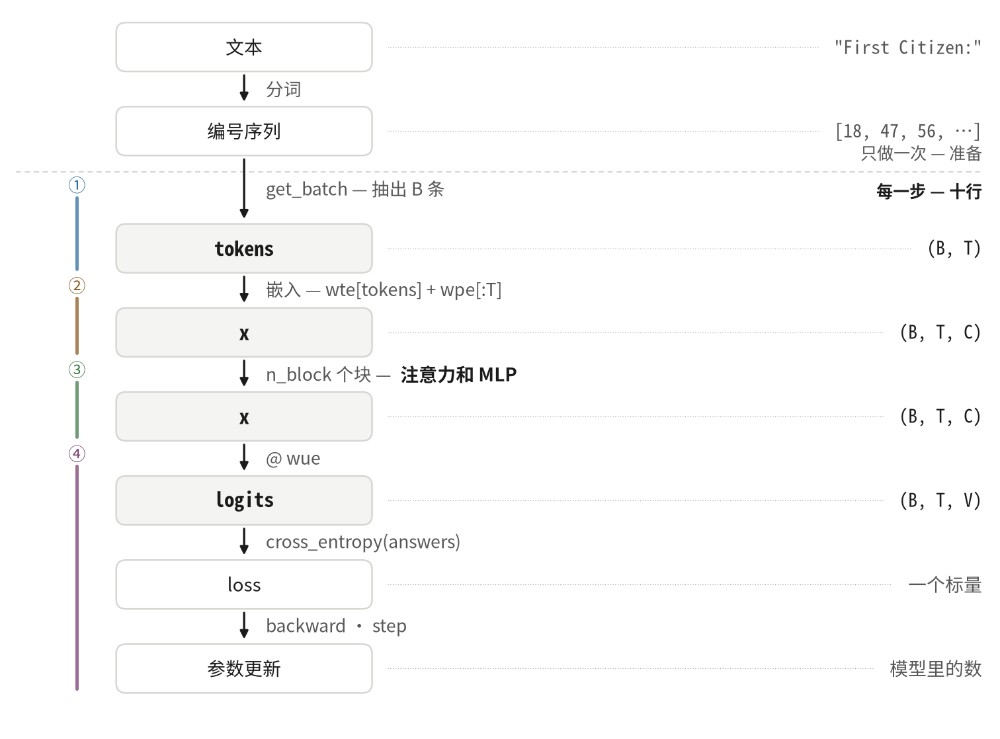
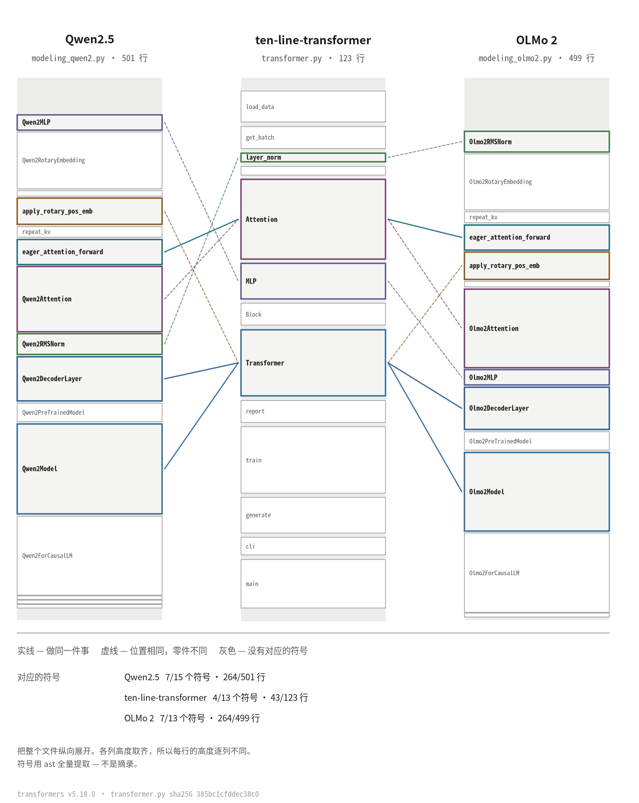

# ten-line-transformer

[🇬🇧 English](README.md) · [🇰🇷 한국어](README.ko.md) · [🇯🇵 日本語](README.ja.md) · **🇨🇳 中文**

一个 Transformer 放在一个 Python 文件里。**123 行**，训练、验证、生成全都在里面。
没有模块级变量，也没有注释 —— 函数名就是注释。

[](LICENSE)
[](transformer.py)
[](#跑一遍)
[](https://colab.research.google.com/github/YoungjuneKwon/ten-line-transformer/blob/main/notebook.ipynb)

小到一次就能读完，又完整到真的能训练。这两件事通常要二选一，这个仓库就是为了说明
不必如此而存在的。

---

## 一个训练步就是十行

```python
tokens, answers = get_batch()               # (B, T), (B, T)
optimizer.zero_grad(set_to_none=True)
x = wte[tokens] + wpe[:T]                   # (B, T, C)
for blk in blocks:                          # n_block 次
    x = x + blk.attn(layer_norm(x))         # (B, T, C)
    x = x + blk.mlp(layer_norm(x))          # (B, T, C)
logits = layer_norm(x) @ wue                # (B, T, V)
loss = cross_entropy(logits, answers)       # 一个标量
loss.backward()
optimizer.step()
```

在真正的文件里，中间六行在
[`Transformer.forward()`](transformer.py#L66-L72) 里，另外四行在
[`train()`](transformer.py#L80-L94) 里。



虚线分开两个时钟。线上面的事只在读入文本时 **做一次**；线下面的事 **每一步都做**，
那就是这十行。横跨这条线的箭头正是 `get_batch` —— 数组只建一次，每一步从里面抽。

单读右边那一列，形状的故事就全在那里。`(B, T)` 以整数进来，变成 `(B, T, C)` 的
浮点数，穿过所有块的过程中一直保持这个形状，在最后一个矩阵处张开成 `(B, T, V)`，
最后收成一个数。

---

## 跑一遍

只要有浏览器，点上面的 Colab 徽章就能跑。在自己的机器上跑，需要 PyTorch 和一个
文本文件。

```bash
pip install torch
curl -O https://raw.githubusercontent.com/karpathy/char-rnn/master/data/tinyshakespeare/input.txt
OMP_NUM_THREADS=1 python transformer.py 200 input.txt
```

用 CPU 就能跑。不需要显卡。

---

## 你会得到同样的数

随机种子固定为 1337。下面是上面那条命令的完整输出，取自一台只有 CPU 的容器，
没有删减。

```
  step     train       val     sec
     0    4.2006    3.9836     0.2
    20    3.4308    3.4368     3.0
    40    3.2868    3.3116     5.7
    60    2.9855    3.1101     8.4
    80    2.7989    2.8680    11.2
   100    2.7746    2.7454    14.1
   120    2.6514    2.6279    16.8
   140    2.6177    2.6219    19.5
   160    2.5419    2.6296    22.2
   180    2.5292    2.5087    24.9
   200    2.5400    2.4785    27.5
```

`sec` 这一列因机器而异。**损失的数值不会。**

对照之前有一点要先知道：这些数属于 **命令**，不属于步数。`transformer.py` 会把你
要的步数分成十次来报告，而每次报告都会从训练批次所用的同一个随机源里抽一个验证
批次。要 2000 步时报告每 200 步落一次，抽取的次数就不同，于是第 200 步读到的是
`2.4812` 而不是 `2.5400`。同样的种子、同样的代码，只是抽取的时间表不同。请用
**同一条命令**之间相互比较。

**同一条命令却得到不同的数，请开一个 issue。** 这是本仓库最想听到的事 ——
要写些什么见 [CONTRIBUTING.md](CONTRIBUTING.md)。

### 那 27 秒之后它写出来的东西

```
AGORAnt ther
F:
uan'se tes? ce ares cikny alllow ld I
Sor sin.

ITander thewineungh hlelus met t there pr sangand berdar the,, the, dpas our me t here,
T bro winomerese vean wil:
Ak, migpr, and ttmy foungomele fe ble, t theran busmun mesI,
```

这不是英文。但看看 200 步已经买到了什么：行在差不多的长度处换行，大写的名字后面
跟着冒号，撇号落在词里面而不是词外面。这些规则没有一条是人写给它的。跑过的只有
上面那十行。

### 四分半之后

`OMP_NUM_THREADS=1 python transformer.py 2000 input.txt` —— 同一颗 CPU 上 265 秒，
损失 1.64：

```
ISABELLA:
Whas our tleagues the say! or would so piar.
Two low hereful Lond May to those here enfenablish,
That is that her here come is some not that thy whid
Is chart gare of certy, and cantive she duke again,
Let I same the heart son's good fathen again,
To be that mone at that pray of heaved have both
As the gates the send speak in the did.

BARTICHARD:
Thou day the king, and of Englest, is an breath;
```

`ISABELLA` 是语料里真实存在的说话人，出现了 129 次。`BARTICHARD` 一次也没有出现
—— 那是模型把看起来像名字的碎片拼出来的。两种行为都来自同样的十行，而且你可以在
笔记本上不到五分钟就看着它们到来。

---

## 模型

```
B=32  T=64  C=128  H=4  n_block=4      可学习张量 19 个，数 811,264 个
wte (65,128)  wpe (64,128)  wue (128,65)
blocks.N.attn.qkv (384,128)  attn.proj (128,128)  mlp.fc (512,128)  mlp.out (128,512)
```

偏置、dropout、可学习的归一化系数、权重绑定都是 **故意去掉的。** 展示结构用不到
它们，去掉之后要读的东西更少。

---

## 同样的位置在真实模型里也有

容易说、难以核对的一句话是 *「大模型也是这么工作的」*。所以这里不是断言，而是画
出来。左右两列都是
[huggingface/transformers](https://github.com/huggingface/transformers) 里真正的
模型代码，固定在标签 `v5.18.0`。每个文件都从头到尾整幅展开 —— 符号是用 `ast`
全量取出的，不是手挑的摘录。



这里 4 个符号、43 行做的事，Qwen2.5 用 7 个符号、264 行来做。差别几乎全部是
**本文件省掉的零件** —— 旋转位置编码、分组查询注意力、缓存、配置管道。不是另一个
想法。

**[docs/line-mapping.md](docs/line-mapping.md) 就是这张图背后的表。** 每一处都给出
本文件的行号，以及 Qwen2.5、Llama、OLMo 2 中对应的行范围，链接直接跳到那一行。
随便点一行，你看到的就是真实的文件。哪一行写错了，那就是值得开 issue 的缺陷。

---

## 它从哪里来

以公开的 [nanoGPT](https://github.com/karpathy/nanoGPT) 为底，用 PyTorch 大幅重写。
按字符比较，整个文件重合 1.3%，注意力主体重合 22.6%。但是 **计算的顺序，十个步骤
完全相同。**

```
qkv 投影 -> 三分 -> 分头 -> q·kᵀ -> 除以 √
        -> 掩码 -> softmax -> @ v -> 合头 -> 输出投影
```

重写的每一步都核对过结果没有变。用同样的种子跑 200 步，训练出的 811,264 个数
**一个比特都不差**（把线程固定为 1 时。多线程时相加顺序会变，最后一位会抖动）。

哪一处来自哪里的逐行对照写在 [NOTICE.md](NOTICE.md) 里。

---

## 书

一本正在写的书《十行读懂 Transformer》（暂定名，韩文）会把这个文件从第一行读到
最后一行。没有书，代码也站得住；书不在这个仓库里。

## 参与

在这里，**订正** 比功能更有价值 —— 这个文件是为了被读，不是为了长大。本仓库最
希望被证伪的那些主张，都列在 [CONTRIBUTING.md](CONTRIBUTING.md) 里。

关于代码如何运作的问题请发到
[Discussions](https://github.com/YoungjuneKwon/ten-line-transformer/discussions)。
Issue 是留给 **错了的东西** 的。

## 许可证

MIT。第三方著作的声明在 [NOTICE.md](NOTICE.md)。

上面的图不是画出来的，是生成的 ——
`python scripts/make_figures.py` 会把四种语言的图全部重画一遍。
